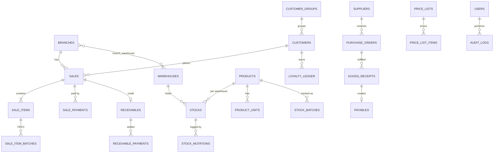

# دليل تصميم نظام POS متعدد الفروع والمخازن (Laravel)

> **الهدف من هذا الملف:** مرجع كامل يشرح لكل وحدة (Module): العمليات، الجداول، الأعمدة، والعلاقات، مع بيان **المشكلة** التي يحلها كل جدول وكل عمود، و**الحل** المعتمد في التصميم. المقصود أنك تقدر تبدأ التنفيذ مباشرة بدون مصدر آخر.
>
> **النطاق:** شركة واحدة، عدة فروع، عدة مخازن، سوق إندونيسي (PPN 11%، Midtrans، Xendit، WhatsApp).

---

## فهرس المحتويات

0. [مبادئ التصميم والاتفاقيات (اقرأها أولاً)](#0-مبادئ-التصميم-والاتفاقيات)
1. [الأساس المشترك: الشركة والفروع والمخازن](#1-الأساس-المشترك-الفروع-والمخازن)
2. [وحدة المخزون ومتعدد المخازن (Inventory)](#2-وحدة-المخزون-inventory--multi-warehouse)
3. [وحدة نقطة البيع والمعاملات (POS)](#3-وحدة-نقطة-البيع-pos--transaksi)
4. [وحدة المشتريات (Purchasing)](#4-وحدة-المشتريات-purchasing)
5. [وحدة المالية (Finance)](#5-وحدة-المالية-finance)
6. [وحدة العملاء والولاء (CRM & Loyalty)](#6-وحدة-العملاء-والولاء-crm--loyalty)
7. [وحدة التقارير والمستندات (Reports & Documents)](#7-وحدة-التقارير-والمستندات)
8. [وحدة الإدارة (Admin)](#8-وحدة-الإدارة-admin)
9. [التكاملات (Integrations)](#9-التكاملات-integrations)
10. [خريطة العلاقات (ERD) وترتيب البناء](#10-خريطة-العلاقات-erd-وترتيب-البناء)
11. [قائمة فحص قبل الإطلاق](#11-قائمة-فحص-قبل-الإطلاق)

---

# 0. مبادئ التصميم والاتفاقيات

هذي القواعد تنطبق على **كل** الجداول. فهمها يوفر عليك تكرار الشرح.

## 0.1 الأعمدة القياسية في كل جدول تقريباً

| العمود | النوع | لماذا موجود؟ |
|---|---|---|
| `id` | `bigIncrements` | مفتاح أساسي. رقمي لأن الربط به أسرع من النصوص. |
| `uuid` (في الجداول التشغيلية) | `uuid` unique | معرّف يُنشأ في **جهاز الكاشير** قبل الإرسال للسيرفر. **المشكلة:** في وضع Offline ما نقدر ننتظر السيرفر يعطينا id. **الحل:** الجهاز يولّد uuid، والسيرفر يرفض التكرار (idempotency) فلا تتكرر الفاتورة عند إعادة المزامنة. |
| `created_at`, `updated_at` | `timestamps` | تتبع وقت الإنشاء والتعديل. |
| `created_by`, `updated_by` | FK → `users` | **المشكلة:** "من عمل هذا السجل؟". **الحل:** تسجيل المستخدم في الجدول نفسه (للقراءة السريعة) بجانب `audit_logs` (للتفصيل). |
| `deleted_at` | `softDeletes` | **المشكلة:** حذف منتج/عميل له فواتير قديمة يكسر التقارير. **الحل:** حذف ناعم، السجل يختفي من الشاشات لكن يبقى للتاريخ. |
| `branch_id` | FK → `branches` | في الجداول التي تخص فرعاً (فواتير، ورديات). **المشكلة:** كيف نعزل بيانات كل فرع ونعمل تقارير لكل فرع؟ **الحل:** عمود صريح + فلتر تلقائي (Global Scope). |

## 0.2 قواعد الأرقام والمال

1. **المبالغ:** `decimal(18,2)` دائماً. لا تستخدم `float` أبداً (أخطاء تقريب: 0.1 + 0.2 ≠ 0.3).
2. **الكميات:** `decimal(18,4)` لأن الكيلو والجرام يحتاجون كسوراً (مثلاً 0.2500 كجم).
3. **المخزون يُخزَّن دائماً بـ "الوحدة الأساسية" (Base Unit)** (مثلاً `pcs`). عند بيع "كرتون" نحوله لقطع بمعامل التحويل. **المشكلة:** لو خزّنا كل وحدة لحالها يصير عندنا 4 أرصدة لنفس المنتج وتتضارب. **الحل:** رصيد واحد بالوحدة الأساسية + جدول تحويل.
4. **لقطة السعر (Snapshot):** في `sale_items` ننسخ السعر والاسم والتكلفة وقت البيع ولا نكتفي بالربط بالمنتج. **المشكلة:** لو غيّرنا سعر المنتج غداً تتغير فواتير الأمس! **الحل:** الفاتورة تحمل نسختها الخاصة.

## 0.3 قاعدة "سجل الحركات" (Ledger) بدل تعديل الرصيد

الأرصدة الحساسة (المخزون، النقاط، الديون) **لا تُعدَّل بالكتابة فوقها فقط**؛ كل تغيير يُسجَّل كحركة في جدول مستقل (`stock_mutations`, `loyalty_ledger`, `receivable_payments`) والرصيد الحالي هو المجموع أو نسخة مخزّنة مؤقتة.

- **المشكلة:** "ليش رصيد المنتج 47؟ من أين جاء؟" لو عدّلنا الرقم مباشرة ما في جواب.
- **الحل:** كل حركة لها سبب ومرجع ومستخدم ووقت، فيمكن تدقيق أي رقم.

## 0.4 قاعدة المعاملات (DB Transaction) والقفل

أي عملية تمس أكثر من جدول (بيع = فاتورة + بنود + دفعات + خصم مخزون + نقاط) تُنفَّذ داخل:

```php
DB::transaction(function () {
    // lockForUpdate() على صف المخزون لمنع بيع نفس القطعة من كاشيرين في نفس اللحظة
});
```

- **المشكلة:** كاشيران يبيعون آخر قطعة بنفس الثانية → مخزون سالب.
- **الحل:** `lockForUpdate()` + معاملة ذرّية (إما كل شيء ينجح أو لا شيء).

## 0.5 هيكل الكود المقترح في Laravel

```
app/
 ├─ Models/              (Eloquent)
 ├─ Services/            (منطق العمل: SaleService, StockService, PromoEngine ...)
 ├─ Actions/             (عملية واحدة: CompleteSale, ReceiveGoods ...)
 ├─ Policies/            (الصلاحيات)
 ├─ Observers/           (تسجيل Audit تلقائياً)
 ├─ Jobs/                (WhatsApp, Sync, Reports الثقيلة)
 ├─ Http/Controllers/Api (لواجهة POS PWA)
 └─ Enums/               (SaleStatus, PaymentMethod ...)
```

**القاعدة الذهبية:** لا تضع منطق المخزون أو الأسعار في الـ Controller. ضعه في Service حتى يُستدعى من POS وAPI والاستيراد بنفس القواعد.

## 0.6 حزم Laravel الموصى بها

| الحاجة | الحزمة |
|---|---|
| الصلاحيات RBAC | `spatie/laravel-permission` |
| سجل التدقيق | `owen-it/laravel-auditing` أو Observer مخصص |
| PDF | `barryvdh/laravel-dompdf` أو `spatie/laravel-pdf` |
| Excel | `maatwebsite/excel` |
| الطوابير | Redis + Laravel Horizon |
| PWA | `manifest.json` + Service Worker (Workbox) + IndexedDB |
| مسح الباركود بالكاميرا | `BarcodeDetector API` أو مكتبة `html5-qrcode`/`zxing-js` |
| الطباعة الحرارية | WebUSB + مكتبة ESC/POS (مثل `escpos-buffer` أو `esc-pos-encoder`) |
| مناطق إندونيسيا | `laravolt/indonesia` |

---

# 1. الأساس المشترك: الفروع والمخازن

## 1.1 لماذا هذه الوحدة أولاً؟
كل شيء في النظام (فاتورة، مخزون، كاشير) يُنسب إلى **فرع** و**مخزن**. إذا أخطأت هنا ستعيد بناء كل شيء لاحقاً.

## 1.2 الفرق بين الفرع والمخزن (سؤال شائع)

| | الفرع (Branch) | المخزن (Warehouse) |
|---|---|---|
| المعنى | مكان بيع/عمل (محل، معرض) | مكان تخزين البضاعة |
| مثال | فرع صنعاء، فرع عدن | مخزن رئيسي، مخزن فرع صنعاء |
| العلاقة | الفرع الواحد قد يبيع من مخزن أو أكثر | المخزن قد يخدم فرعاً أو عدة فروع (مخزن مركزي) |

**المشكلة:** لو دمجناهما، ما نقدر نمثل "مخزن مركزي يغذي 5 فروع".
**الحل:** جدولان منفصلان + جدول ربط عند الحاجة.

## 1.3 الجداول

### `company_settings` (إعدادات الشركة)
**لماذا؟** شركة واحدة فقط، فنخزن بياناتها (اسم، رقم ضريبي NPWP، شعار، عنوان) في جدول مفاتيح/قيم لتظهر في الفواتير.

| العمود | النوع | لماذا؟ |
|---|---|---|
| `key` | string unique | اسم الإعداد (`company_name`, `npwp`, `default_tax_mode`...). |
| `value` | text / json | القيمة. JSON لأن بعضها قوائم (مثل طرق الدفع المفعّلة). |
| `group` | string | تجميع الإعدادات في شاشة الإدارة (general, tax, receipt, loyalty). |

### `branches` (الفروع)
| العمود | النوع | لماذا؟ |
|---|---|---|
| `id` | PK | |
| `code` | string(10) unique | رمز قصير يدخل في أرقام الفواتير (`JKT-INV-0001`). **المشكلة:** رقم فاتورة بدون رمز الفرع يتكرر بين الفروع. |
| `name` | string | الاسم المعروض. |
| `address`, `phone` | text/string | تظهر في رأس الإيصال. |
| `region_id` | FK nullable | ربط بالمنطقة (للتقارير الجغرافية). |
| `invoice_prefix` | string | بادئة ترقيم الفواتير لكل فرع. |
| `receipt_footer` | text | رسالة أسفل الإيصال حسب الفرع. |
| `is_active` | boolean | إيقاف فرع بدون حذفه. |

### `warehouses` (المخازن)
| العمود | النوع | لماذا؟ |
|---|---|---|
| `id` | PK | |
| `code`, `name` | string | تعريف المخزن. |
| `type` | enum(`main`,`branch`,`damaged`,`transit`) | **المشكلة:** البضاعة التالفة أو التي في الطريق بين مخزنين لا يجب أن تظهر كمتاحة للبيع. **الحل:** مخازن افتراضية من نوع `damaged` و`transit` خارج المتاح. |
| `is_sellable` | boolean | هل يجوز البيع منه في POS؟ (المخزن المركزي غالباً لا). |
| `address` | text | |
| `is_active` | boolean | |

### `branch_warehouse` (جدول ربط)
| العمود | لماذا؟ |
|---|---|
| `branch_id`, `warehouse_id` | ربط many-to-many: أي مخازن يحق للفرع البيع منها. |
| `is_default` | المخزن الافتراضي الذي يخصم منه الكاشير تلقائياً. **المشكلة:** الكاشير لا يختار مخزناً في كل عملية بيع. |
| `priority` | ترتيب السحب إذا نفد الأول (اختياري). |

### `user_branches` (ربط المستخدم بالفروع)
| العمود | لماذا؟ |
|---|---|
| `user_id`, `branch_id` | **المشكلة:** كاشير فرع عدن يجب ألا يرى مبيعات صنعاء. **الحل:** المستخدم يرى فقط الفروع المسموحة له. |
| `is_default` | الفرع الذي يفتح تلقائياً عند الدخول. |

### العمليات (Operations)
1. إنشاء/تعديل/تعطيل فرع.
2. إنشاء مخزن وربطه بفرع/فروع وتحديد الافتراضي.
3. تعيين المستخدمين للفروع.
4. **Global Scope:** `BranchScope` يضيف `where branch_id in (فروع المستخدم)` تلقائياً.

```php
// مثال Global Scope
class BranchScope implements Scope {
    public function apply(Builder $b, Model $m) {
        if (auth()->check() && !auth()->user()->hasRole('super-admin')) {
            $b->whereIn($m->getTable().'.branch_id', auth()->user()->branchIds());
        }
    }
}
```

---

# 2. وحدة المخزون (Inventory & Multi-Warehouse)

## 2.1 خريطة الوحدة

```
categories ─┐
brands ─────┼─► products ─► product_units ◄─ units
            │       │  └──► product_barcodes
            │       ├──► product_components (Kits)
            │       └──► reorder_rules
warehouses ─┴─► stocks ─► stock_batches
                  └────► stock_mutations (سجل كل حركة)
stock_transfers ► stock_transfer_items
stock_opnames   ► stock_opname_items
```

## 2.2 المنتجات

### `categories` (التصنيفات)
**لماذا؟** تنظيم المنتجات + تقارير حسب التصنيف + قواعد العروض على تصنيف كامل.

| العمود | لماذا؟ |
|---|---|
| `parent_id` (self FK) | تصنيفات متداخلة (مشروبات ← عصائر). **المشكلة:** تصنيف مسطح لا يكفي لمتجر كبير. |
| `name`, `slug` | الاسم والرابط. |
| `is_active`, `sort_order` | الإظهار والترتيب في شاشة POS. |

### `brands` (العلامات التجارية) — اختياري لكنه مفيد للتقارير والعروض.

### `units` (الوحدات)
| العمود | لماذا؟ |
|---|---|
| `name` | (pcs, box, kg, karton). |
| `short_name` | رمز للإيصال (pcs, kg). |
| `allow_decimal` | **المشكلة:** لا يصح بيع 1.5 "علبة" لكن يصح 1.5 "كجم". **الحل:** علَم يمنع الكسور في الوحدات العدّية. |

### `products` (المنتجات)
| العمود | النوع | لماذا؟ |
|---|---|---|
| `id` | PK | |
| `sku` | string unique | رمز داخلي ثابت لا يتغير حتى لو تغيّر الباركود. |
| `name` | string | الاسم. |
| `category_id`, `brand_id` | FK | التصنيف. |
| `type` | enum(`simple`,`composite`,`service`) | **المشكلة:** المنتج المركب (Kit) والخدمة (توصيل، تركيب) لها سلوك مخزون مختلف. `service` لا يخصم مخزوناً، `composite` يخصم مكوّناته. |
| `base_unit_id` | FK units | الوحدة الأساسية التي يُحسب بها المخزون. |
| `cost_price` | decimal | متوسط التكلفة الحالي (Moving Average) لحساب الربح. |
| `base_price` | decimal | سعر البيع الافتراضي (قبل قوائم الأسعار). |
| `tax_mode` | enum(`none`,`exclusive`,`inclusive`) | **المشكلة:** بعض المنتجات معفاة من PPN. السعر قد يكون شاملاً الضريبة أو لا. |
| `tax_rate_id` | FK nullable | نسبة الضريبة (11%). |
| `track_stock` | boolean | الخدمات لا تتبع مخزوناً. |
| `track_batch` | boolean | هل يحتاج رقم دفعة (Batch)؟ |
| `track_expiry` | boolean | هل له تاريخ صلاحية؟ (يفعّل FEFO). |
| `min_stock` | decimal | حد أدنى سريع (يُكمَّل بـ `reorder_rules`). |
| `image` | string | صورة في شاشة POS. |
| `is_active`, `is_sellable`, `is_purchasable` | boolean | إيقاف البيع أو الشراء بشكل مستقل. |

> **لماذا `track_batch` و`track_expiry` أعمدة وليست دائماً مفعلة؟** لأن الدفعات تعقّد البيع وتبطئه. الصابون لا يحتاجها، الحليب يحتاجها. التفعيل انتقائي يوفّر الأداء والبساطة.

### `product_units` (الوحدات المتعددة وتحويلها)
**المشكلة:** المنتج يُشترى بالكرتون ويُباع بالقطعة والعلبة. كيف نخصم المخزون صح؟
**الحل:** كل منتج له عدة وحدات، ولكل وحدة **معامل تحويل** إلى الوحدة الأساسية.

| العمود | لماذا؟ |
|---|---|
| `product_id`, `unit_id` | أي منتج وأي وحدة. |
| `conversion_factor` | كم وحدة أساسية في هذه الوحدة. مثال: Box = 12، Karton = 144، pcs = 1. |
| `barcode` (اختياري) | باركود خاص بالكرتون يختلف عن باركود القطعة. |
| `sell_price` | سعر بيع هذه الوحدة (قد لا يكون = سعر القطعة × 12 بسبب خصم الكمية). |
| `is_default_sale`, `is_default_purchase` | الوحدة التي تظهر افتراضياً في POS وفي أمر الشراء. |

**مثال حسابي:** بيع 2 كرتون (معامل 144) → الخصم من المخزن = 2 × 144 = **288 pcs**.

### `product_barcodes` (باركودات متعددة)
**المشكلة:** المنتج الواحد قد يأتي بعدة باركودات (مورّدين مختلفين، تغيير تغليف).
| العمود | لماذا؟ |
|---|---|
| `product_id`, `product_unit_id` | لأي منتج/وحدة. |
| `barcode` (unique) | الرمز. فهرس فريد لأن البحث بالمسح يجب أن يكون فورياً. |

### `product_components` (المنتجات المركّبة / Kits)
**المشكلة:** "سلة هدايا" تتكون من 3 منتجات. عند بيعها يجب خصم المكوّنات لا السلة.
| العمود | لماذا؟ |
|---|---|
| `composite_product_id` | المنتج المركّب. |
| `component_product_id` | المكوّن. |
| `quantity` | كمية المكوّن بوحدته الأساسية. |

**العملية:** `SaleService` يرى `type=composite` فيفكّكه لمكوّنات ويخصم كل واحد ويسجل `stock_mutations` لكل مكوّن، وتبقى سطر الفاتورة واحداً.

## 2.3 المخزون الفعلي

### `stocks` (رصيد المنتج في المخزن)
**لماذا؟** سطر واحد لكل (منتج × مخزن) للقراءة السريعة في POS دون جمع آلاف الحركات.

| العمود | لماذا؟ |
|---|---|
| `product_id`, `warehouse_id` | **فهرس فريد مركّب** (لا يتكرر الزوج). |
| `quantity` | الرصيد الحالي بالوحدة الأساسية. |
| `reserved_quantity` | **المشكلة:** سلة معلّقة (Hold) أو تحويل مرسل لم يُستلم. **الحل:** الكمية المحجوزة، والمتاح = quantity − reserved. |
| `avg_cost` | متوسط التكلفة في هذا المخزن. |
| `last_counted_at` | آخر جرد (للتنبيه بتأخر الجرد). |

> الرصيد هنا **نسخة مُشتقة**؛ المصدر الحقيقي هو `stock_mutations`. نحدّثه داخل نفس المعاملة التي تكتب الحركة.

### `stock_batches` (الدفعات وتواريخ الصلاحية)
**المشكلة:** حليب وصل على دفعتين بتواريخ انتهاء مختلفة. إن بعنا الأحدث أولاً انتهت صلاحية القديم وخسرنا.
**الحل:** **FEFO** (First Expired, First Out): نبيع الأقرب انتهاءً أولاً.

| العمود | لماذا؟ |
|---|---|
| `product_id`, `warehouse_id` | موقع الدفعة. |
| `batch_number` | رقم الدفعة من المورّد (لسحب دفعة معيبة عند الاستدعاء). |
| `expiry_date` | أساس ترتيب FEFO. |
| `quantity` | المتبقي من هذه الدفعة. |
| `cost_price` | تكلفة هذه الدفعة (دفعات مختلفة بأسعار مختلفة). |
| `received_at` | تاريخ الاستلام. |
| `goods_receipt_item_id` | تتبّع من أي استلام جاءت. |

**خوارزمية الخصم (FEFO):**
```php
$batches = StockBatch::where('product_id',$pid)->where('warehouse_id',$wid)
    ->where('quantity','>',0)->where('expiry_date','>=',today())
    ->orderBy('expiry_date')->lockForUpdate()->get();
// اسحب من الأقدم حتى تكتمل الكمية، وسجّل كل سحب في sale_item_batches
```
**نقطة مهمة:** الدفعات منتهية الصلاحية **تُستبعد** من البيع (`expiry_date >= today`) وتظهر في تقرير "قريب الانتهاء/منتهي".

### `stock_mutations` (سجل حركات المخزون) — أهم جدول في الوحدة
**المشكلة:** تدقيق أي رقم + تقرير حركة الصنف + كشف السرقات والأخطاء.

| العمود | لماذا؟ |
|---|---|
| `product_id`, `warehouse_id`, `batch_id` | ماذا وأين. |
| `type` | enum: `purchase`, `sale`, `sale_return`, `supplier_return`, `transfer_out`, `transfer_in`, `opname_adjust`, `damage`, `kit_consume`, `initial`. |
| `quantity` | موجب = دخول، سالب = خروج (بالوحدة الأساسية). |
| `balance_after` | الرصيد بعد الحركة. **المشكلة:** إعادة بناء الرصيد التاريخي ثقيلة. **الحل:** حفظ الرصيد مع كل حركة. |
| `unit_cost` | تكلفة الوحدة وقت الحركة (لتقييم المخزون). |
| `reference_type`, `reference_id` | علاقة Polymorphic بالمستند المصدر (فاتورة، استلام، تحويل...). |
| `note` | ملاحظة. |
| `created_by`, `created_at` | من ومتى. |

**قاعدة:** هذا الجدول **Append-only**: لا تعديل ولا حذف. التصحيح يكون بحركة عكسية.

## 2.4 تحويل المخزون بين المخازن

### `stock_transfers`
**المشكلة:** نقل بضاعة من المخزن الرئيسي لفرع. أثناء الطريق البضاعة ليست في أي مخزن، وقد تضيع أو تصل ناقصة.
**الحل:** دورة حياة بثلاث مراحل: **Draft → Sent → Received** مع حالة "في الطريق".

| العمود | لماذا؟ |
|---|---|
| `transfer_number` | رقم المستند. |
| `from_warehouse_id`, `to_warehouse_id` | المصدر والوجهة (CHECK: ليسا متساويين). |
| `status` | enum: `draft`, `sent`, `partially_received`, `received`, `cancelled`. |
| `sent_at`, `sent_by` | وقت وشخص الإرسال (هنا يُخصم من المصدر). |
| `received_at`, `received_by` | وقت وشخص الاستلام (هنا يُضاف للوجهة). |
| `notes` | |

### `stock_transfer_items`
| العمود | لماذا؟ |
|---|---|
| `transfer_id`, `product_id`, `batch_id` | البند. |
| `quantity_sent` | ما أُرسل. |
| `quantity_received` | ما وصل فعلاً. الفرق = فاقد/تالف ويُسجل كحركة `damage`. |
| `unit_id`, `conversion_factor` (snapshot) | وحدة الإدخال ومعاملها لحظتها. |

**السيناريو الكامل:**
1. **Draft:** أمين المخزن يجهّز القائمة (لا تأثير على الرصيد).
2. **Send:** خصم من المصدر `transfer_out` + إضافة لمخزن `transit` الوهمي.
3. **Receive:** استلام الفرع، خصم من transit + إضافة للوجهة `transfer_in`. أي نقص يُوثَّق بسبب.

## 2.5 الجرد (Stock Opname)

### `stock_opnames`
**المشكلة:** الرصيد في النظام ≠ الرصيد على الرف (سرقة، تلف، خطأ).
**الحل:** جلسة جرد دورية تقارن وتُسوّي مع توثيق.

| العمود | لماذا؟ |
|---|---|
| `opname_number`, `warehouse_id` | الجلسة والمخزن (الجرد لكل مخزن). |
| `status` | `draft` → `counting` → `pending_approval` → `approved` / `cancelled`. |
| `snapshot_at` | لحظة أخذ لقطة الأرصدة (البيع مستمر أثناء الجرد!). |
| `approved_by`, `approved_at` | **ضبط:** التسوية تغيّر الأرصدة، فتحتاج موافقة مدير. |

### `stock_opname_items`
| العمود | لماذا؟ |
|---|---|
| `product_id`, `batch_id` | |
| `system_quantity` | الرصيد وقت اللقطة. |
| `counted_quantity` | ما عدّه الموظف. |
| `difference` | counted − system (موجب زيادة، سالب نقص). |
| `cost_impact` | قيمة الفرق المالية للتقرير. |
| `reason` | سبب الفرق (تلف، سرقة، خطأ إدخال). |

**عند الاعتماد:** لكل سطر فيه فرق نكتب `stock_mutations` نوع `opname_adjust` ونحدّث `stocks`.
**حل مشكلة البيع أثناء الجرد:** نحسب الفرق بالنسبة للحركات بعد `snapshot_at`، أو نمنع البيع من المخزن أثناء الجرد القصير.

## 2.6 إعادة الطلب والتنبيهات

### `reorder_rules`
| العمود | لماذا؟ |
|---|---|
| `product_id`, `warehouse_id` | القاعدة لكل منتج/مخزن (فرع كبير يحتاج أكثر). |
| `reorder_point` | عندما ينزل الرصيد المتاح إليه نُنبّه. |
| `reorder_quantity` | الكمية المقترحة للطلب. |
| `preferred_supplier_id` | المورّد الافتراضي لتوليد PO تلقائي. |
| `lead_time_days` | مدة التوريد، لحساب نقطة إعادة الطلب بدقة. |

**العملية (Scheduler يومي):**
```php
// app/Console/Kernel.php → $schedule->job(new CheckReorderPoints)->dailyAt('06:00');
```
1. يحسب المتاح = `quantity − reserved_quantity` لكل قاعدة.
2. إن كان ≤ `reorder_point` → ينشئ **اقتراح شراء** (Draft PO) مجمّعاً حسب المورّد + يرسل إشعاراً.

### `notifications` (جدول Laravel القياسي)
إشعارات النظام (مخزون منخفض، قرب انتهاء الصلاحية، طلب موافقة خصم...). **لماذا القياسي؟** لأن Laravel يوفّر القنوات (database, mail, WhatsApp) جاهزة.

### العمليات الكاملة للوحدة
| العملية | تفاصيل |
|---|---|
| إضافة/تعديل منتج | مع وحداته وباركوداته في معاملة واحدة. |
| رصيد افتتاحي | حركة `initial` لكل منتج/مخزن. |
| بحث سريع | فهارس على `barcode`, `sku`, `name` (FULLTEXT للاسم). |
| تحويل مخزون | Draft → Send → Receive. |
| جرد | Draft → Counting → Approve. |
| تسجيل تالف | حركة `damage` + سبب. |
| تقرير بطاقة الصنف | استعلام على `stock_mutations`. |
| تقييم المخزون | Σ(quantity × avg_cost) حسب المخزن. |

---

# 3. وحدة نقطة البيع والمعاملات (POS & Transaksi)

## 3.1 خريطة الوحدة

```
pos_terminals ─► pos_shifts ─► sales ─► sale_items ─► sale_item_batches
                      │          ├────► sale_payments ─► payment_gateway_transactions
                      │          ├────► sale_promotions
                      │          └────► discount_approvals
held_carts ─► held_cart_items
price_lists ─► price_list_items
promotions ─► promotion_rules / promotion_rewards / promotion_products
sale_returns ─► sale_return_items
```

## 3.2 الكاشير والوردية

### `pos_terminals` (أجهزة/نقاط الكاشير)
**لماذا؟** معرفة أي جهاز أصدر الفاتورة، وربطه بالطابعة والمخزن الافتراضي.

| العمود | لماذا؟ |
|---|---|
| `branch_id`, `warehouse_id` | فرع الجهاز ومخزنه الافتراضي. |
| `name`, `device_uuid` | اسم الجهاز ومعرّف المتصفح (لوضع Offline وتتبع المصدر). |
| `printer_type` | enum(`80mm`,`58mm`,`none`) لتنسيق الإيصال. |
| `printer_config` (json) | vendorId/productId لـ WebUSB وعدد الأحرف في السطر. |

### `pos_shifts` (الورديات)
**المشكلة:** "العجز في الصندوق" — كل كاشير يستلم صندوقاً ويسلّمه، ومن يتحمل الفرق؟
**الحل:** وردية مفتوحة/مغلقة برصيد افتتاحي ورصيد متوقع مقابل فعلي.

| العمود | لماذا؟ |
|---|---|
| `terminal_id`, `cashier_id`, `branch_id` | من وأين. |
| `opened_at`, `closed_at` | حدود الوردية (كل فاتورة تُربط بها). |
| `opening_cash` | النقد الافتتاحي (الفكّة). |
| `expected_cash` | = opening + مبيعات نقدية − مرتجعات نقدية ± حركات الصندوق. |
| `actual_cash` | ما عدّه الكاشير عند الإغلاق. |
| `cash_difference` | actual − expected (عجز/زيادة). |
| `status` | `open`, `closed`. |
| `note` | تبرير الفرق. |

### `cash_movements`
مصروف صغير من الصندوق أو إيداع/سحب أثناء الوردية، حتى لا يظهر عجز وهمي: `shift_id`, `type(in/out)`, `amount`, `reason`.

## 3.3 البحث والباركود (واجهة)

- **بحث:** `GET /api/pos/products?q=...&warehouse_id=..` يبحث في `product_barcodes.barcode` (مطابقة تامة أولاً) ثم `sku` ثم `name` (LIKE/FULLTEXT) ويرجع السعر المناسب والمتاح.
- **ماسح الكاميرا (PWA):** `navigator.mediaDevices.getUserMedia` + `BarcodeDetector`؛ عند القراءة ينفّذ نفس نداء الباركود. **مشكلة:** ليس كل المتصفحات تدعم `BarcodeDetector`. **حل:** مكتبة ZXing كبديل (Polyfill).
- **الأداء:** تخزين المنتجات الأساسية في **IndexedDB** على الجهاز لتصير الاستجابة فورية وتعمل Offline.

## 3.4 السلة المعلّقة (Hold / Resume)

### `held_carts`
**المشكلة:** زبون يتذكر أنه نسي محفظته، والطابور واقف. نحتاج حفظ السلة وخدمة غيره ثم استكمالها.
| العمود | لماذا؟ |
|---|---|
| `uuid`, `terminal_id`, `cashier_id`, `branch_id` | مصدر السلة. |
| `customer_id` nullable | ربط عميل إن وُجد. |
| `label` | اسم مختصر ("الأخ أحمد - قميص أزرق"). |
| `cart_payload` (json) | السلة كاملة (بنود، خصومات). **لماذا JSON؟** سلة مؤقتة لا نحتاج الاستعلام داخلها، وتتغير بنيتها كثيراً. |
| `expires_at` | تنظيف تلقائي للسلال القديمة. |

> **هل نحجز المخزون للسلة المعلّقة؟** خيار تصميمي. الافتراضي: **لا نحجز** (لا تؤثر على المخزون) ونتحقق عند الاستكمال. الحجز عبر `reserved_quantity` اختياري للسلع النادرة.

## 3.5 قوائم الأسعار (Multi-Price List)

### `price_lists`
**المشكلة:** سعر الجملة ≠ سعر التجزئة ≠ سعر الأعضاء/VIP. تعديل سعر كل منتج لكل شريحة غير عملي.
**الحل:** قوائم أسعار تُربط بمجموعة العميل.

| العمود | لماذا؟ |
|---|---|
| `name`, `code` | (Retail, Wholesale, Gold). |
| `is_default` | القائمة المستخدمة إن لم يُحدد العميل. |
| `valid_from`, `valid_until` | قوائم موسمية. |
| `is_active` | |

### `price_list_items`
| العمود | لماذا؟ |
|---|---|
| `price_list_id`, `product_id`, `unit_id` | السعر لكل منتج ووحدة. |
| `price` | السعر. |
| `min_qty` | **سعر الكمية (Qty Break)**: 1+ بـ 10,000 ، 10+ بـ 9,000 (أسطر متعددة لنفس المنتج). |

**خوارزمية اختيار السعر (ترتيب الأولوية):**
1. سعر عرض مفعّل (Promo) إن وجد → 2. سعر قائمة العميل مع `min_qty` المناسب → 3. القائمة الافتراضية → 4. `product_units.sell_price` → 5. `products.base_price`.

## 3.6 محرك العروض (Promo Engine)

**المشكلة:** عروض متنوعة (خصم %، خصم مبلغ، اشترِ 10 بخصم، حزمة، اشترِ 2 واحصل على 1) وتتغير باستمرار، وكتابتها داخل الكود تعني تعديل الكود لكل عرض.
**الحل:** جدول عروض **قابل للتهيئة** (Data-driven) ومحرك واحد يقيّمها.

### `promotions`
| العمود | لماذا؟ |
|---|---|
| `name`, `code` | الاسم والرمز. |
| `type` | enum: `percent_discount`, `fixed_discount`, `qty_break`, `bundle`, `buy_x_get_y`. |
| `priority` | عند تعارض عرضين، الأعلى أولاً. |
| `is_exclusive` | لا يجتمع مع غيره. |
| `valid_from`, `valid_until` | فترة العرض. |
| `days_of_week` (json), `time_from`, `time_to` | عروض "Happy Hour" أو "الجمعة فقط". |
| `branch_scope` | كل الفروع أو محددة. |
| `customer_group_id` nullable | عرض لشريحة معيّنة. |
| `max_usage_total`, `max_usage_per_customer` | سقف الاستخدام (يمنع الاستغلال). |
| `is_active` | |

### `promotion_rules` (الشرط)
`promotion_id`, `target_type(product/category/brand/cart)`, `target_id`, `min_qty`, `min_amount`. مثال: "اشترِ 3 من التصنيف X".

### `promotion_rewards` (المكافأة)
`promotion_id`, `reward_type(percent/fixed/free_product/special_price)`, `value`, `reward_product_id`, `reward_qty`.
- **buy_x_get_y:** rule = اشترِ 2 من المنتج A، reward = مجاني 1 من المنتج A (أو B).
- **bundle:** rule = وجود A+B+C معاً، reward = سعر خاص للحزمة.

### `sale_promotions` (العروض المطبّقة فعلاً)
`sale_id`, `sale_item_id` nullable, `promotion_id`, `discount_amount`, `description`. **لماذا؟** إثبات سبب كل خصم في الفاتورة وتقارير فعالية العروض.

**ترتيب التنفيذ في `PromoEngine`:**
```
1. اجلب العروض الفعّالة (الفرع/الوقت/الشريحة)
2. رتّبها حسب priority
3. لكل بند: تحقق rules → احسب reward
4. لو is_exclusive → توقّف بعد أول عرض
5. أعد قائمة الخصومات + البنود المجانية
```

## 3.7 الخصم بالموافقة (Discount Approval)

**المشكلة:** الكاشير يعطي صديقه خصم 50%. نحتاج ضبطاً.
**الحل:** سقف خصم لكل دور؛ ما فوق السقف يحتاج موافقة مشرف.

### `discount_approvals`
| العمود | لماذا؟ |
|---|---|
| `sale_uuid` / `sale_id` | الفاتورة المعلقة (قد لا تكون مُنشأة بعد). |
| `requested_by` | الكاشير. |
| `discount_type`, `discount_value`, `discount_amount` | ما طُلب. |
| `reason` | تبرير إلزامي. |
| `status` | `pending`, `approved`, `rejected`, `expired`. |
| `approved_by`, `approved_at` | المشرف. |
| `approval_method` | `remote` (إشعار) أو `pin` (رمز المشرف على نفس الجهاز). |
| `expires_at` | الموافقة صالحة دقائق فقط. |

**الصلاحيات:** `max_discount_percent` على مستوى الدور (في `roles` أو جدول `role_limits`).

## 3.8 الضريبة PPN 11%

### `tax_rates`
`name` (PPN), `rate` (11.00), `type(ppn/pph)`, `is_inclusive_default`, `is_active`, `valid_from`. **لماذا نخزن النسبة؟** لأنها قد تتغير مستقبلاً، والفواتير القديمة تحتفظ بنسبتها.

**الحساب:**

| الوضع | المعادلة |
|---|---|
| **Exclusive** (السعر قبل الضريبة) | `tax = subtotal × 11%` ، `total = subtotal + tax` |
| **Inclusive** (السعر شامل) | `tax = total × 11 / 111` ، `subtotal = total − tax` |

> في `sale_items` نخزن `tax_rate`, `tax_amount`, `tax_mode` كـ Snapshot لكل بند، لأن الفاتورة الواحدة قد تحوي منتجات معفاة ومنتجات خاضعة.

## 3.9 الفاتورة

### `sales`
| العمود | النوع | لماذا؟ |
|---|---|---|
| `id`, `uuid` | | `uuid` من الجهاز لمنع التكرار عند المزامنة. |
| `invoice_number` | string unique | رقم رسمي متسلسل لكل فرع (`JKT-20261105-0001`). يُولَّد في السيرفر (أو نطاق محجوز للجهاز في Offline). |
| `branch_id`, `warehouse_id`, `terminal_id`, `shift_id`, `cashier_id` | FK | السياق التشغيلي. |
| `customer_id` | FK nullable | زبون عابر = NULL. |
| `price_list_id` | FK | القائمة المستخدمة (للتدقيق). |
| `status` | enum | `draft`, `completed`, `partially_paid`, `unpaid` (آجل), `void`, `refunded`. |
| `sale_type` | enum | `pos`, `credit`, `online`. |
| `subtotal` | decimal | قبل الخصم والضريبة. |
| `discount_total` | decimal | مجموع الخصومات (بنود + عام + نقاط + قسيمة). |
| `tax_total` | decimal | مجموع PPN. |
| `shipping_fee`, `rounding` | decimal | التوصيل وتقريب النقد (إندونيسيا تُقرّب لأقرب 100 غالباً). |
| `grand_total` | decimal | الإجمالي النهائي. |
| `paid_amount`, `change_amount` | decimal | المدفوع والباقي للزبون. |
| `due_amount` | decimal | المتبقي (للآجل) → ينتج سجلاً في `receivables`. |
| `due_date` | date | موعد استحقاق الآجل. |
| `points_earned`, `points_redeemed` | int | ولاء. |
| `voucher_id` | FK nullable | القسيمة المستخدمة. |
| `is_synced`, `synced_at`, `offline_created_at` | | تتبّع المبيعات القادمة من وضع Offline. |
| `note` | text | |
| `voided_by`, `voided_at`, `void_reason` | | الإلغاء بسبب موثّق، لا حذف أبداً. |

### `sale_items`
| العمود | لماذا؟ |
|---|---|
| `sale_id`, `product_id` | |
| `product_name`, `sku` (snapshot) | اسم المنتج وقت البيع. |
| `unit_id`, `conversion_factor` | الوحدة المباعة ومعاملها. |
| `quantity` | بوحدة البيع. |
| `base_quantity` | = quantity × conversion_factor (المخصوم فعلياً). |
| `unit_price` | سعر الوحدة بعد اختيار القائمة. |
| `unit_cost` | التكلفة وقت البيع (لحساب الربح لاحقاً **بدون** رجوع للمنتج). |
| `discount_amount`, `discount_percent` | خصم البند. |
| `tax_mode`, `tax_rate`, `tax_amount` | ضريبة البند. |
| `line_total` | صافي السطر. |
| `is_free_item` | بند مجاني من عرض (B1G1). |
| `parent_item_id` | مكوّنات الـ Kit تحت بند المركّب. |

### `sale_item_batches`
`sale_item_id`, `batch_id`, `quantity`, `unit_cost`. **لماذا؟** سطر فاتورة واحد قد يسحب من دفعتين؛ نحتاج معرفة أي دفعة بيعت (لسحب المنتج عند الاستدعاء ولإرجاعه لنفس الدفعة).

### `sale_payments` (الدفع المتعدد)
**المشكلة:** زبون يدفع جزءاً نقداً وجزءاً تحويلاً.
| العمود | لماذا؟ |
|---|---|
| `sale_id` | |
| `method` | enum: `cash`, `bank_transfer`, `midtrans`, `xendit`, `pay_later`, `points`, `voucher`. |
| `amount` | المبلغ بهذه الطريقة. |
| `reference_number` | رقم الحوالة/المعاملة. |
| `bank_account_id` | حساب الشركة المستقبِل (للتحويل). |
| `status` | `pending`, `paid`, `failed`, `expired`, `refunded` (البوابات غير فورية!). |
| `paid_at` | |
| `gateway_transaction_id` | ربط بجدول البوابة. |

### `payment_gateway_transactions`
**المشكلة:** Midtrans/Xendit يردّان لاحقاً عبر Webhook؛ قد يصل الإشعار مرتين أو متأخراً، وقد ينقطع الإنترنت قبل ظهور النتيجة.
| العمود | لماذا؟ |
|---|---|
| `provider` | `midtrans`/`xendit`. |
| `order_id` / `external_id` | المعرّف الذي أرسلناه للبوابة (unique). |
| `payable_type`, `payable_id` | Polymorphic: دفع فاتورة بيع **أو** دفع دين عميل (Customer Portal). |
| `payment_type` | qris, va_bca, ewallet... |
| `amount`, `status` | الحالة حسب البوابة. |
| `payment_url`, `qr_string`, `va_number` | ما نعرضه للزبون. |
| `expires_at` | انتهاء الرمز. |
| `raw_request`, `raw_response` (json) | لقطة كاملة للتحقيق في الخلافات. |
| `signature_verified` | تحقق من توقيع Webhook (أمان). |
| `webhook_received_at` | |

**قواعد التكامل الآمن:**
1. التحقق من **توقيع** الـ Webhook قبل تصديق أي شيء.
2. المعالجة **Idempotent**: نفس الإشعار مرتين لا يسجل دفعتين.
3. لا نعتمد على إعادة توجيه المتصفح كإثبات دفع؛ **الـ Webhook هو المصدر الموثوق**.
4. Job مجدول يستعلم عن المعاملات المعلّقة (Reconciliation).

### `payment_methods` / `bank_accounts` (إعدادات)
حسابات الشركة البنكية للتحويل، والطرق المفعّلة لكل فرع، ورسوم البوابة (`fee_percent`, `fee_flat`) لحساب الربح الصافي.

## 3.10 مرتجعات المبيعات

### `sale_returns` + `sale_return_items`
**المشكلة:** زبون يرجع منتجاً. يجب ربط المرتجع بالفاتورة الأصلية، إعادة المخزون (أو تسجيله تالفاً)، رد المبلغ، وعكس النقاط والضريبة.

| `sale_returns` | لماذا؟ |
|---|---|
| `sale_id`, `return_number`, `branch_id` | |
| `reason` | تبرير. |
| `refund_method`, `refund_amount` | طريقة وقيمة الرد (نقد/رصيد/تقليل دين). |
| `status`, `approved_by` | يحتاج موافقة. |

| `sale_return_items` | لماذا؟ |
|---|---|
| `sale_item_id`, `quantity`, `base_quantity` | يمنع إرجاع أكثر مما بيع. |
| `condition` | `resellable` (يعود للمخزون) / `damaged` (مخزن التالف). |
| `batch_id` | إعادته لنفس الدفعة. |

## 3.11 وضع Offline (الأصعب في المشروع)

**المشكلة:** الإنترنت ينقطع والبيع لا يتوقف.
**الحل:** PWA + Service Worker + IndexedDB + طابور مزامنة.

### المكوّنات
| المكوّن | الدور |
|---|---|
| Service Worker | تخزين ملفات التطبيق (Cache First). |
| IndexedDB: `products`, `prices`, `customers` | نسخة محلية للبحث. |
| IndexedDB: `pending_sales` | فواتير مكتملة لم تُرسل. |
| Background Sync / محاولة دورية | إرسالها عند عودة الاتصال. |

### جدول السيرفر: `offline_sync_logs`
| العمود | لماذا؟ |
|---|---|
| `device_uuid`, `sale_uuid` | مصدر الفاتورة. |
| `status` | `received`, `processed`, `conflict`, `failed`. |
| `error_message` | سبب الفشل (مخزون غير كافٍ، منتج محذوف). |
| `payload` (json) | النسخة المرسلة للمراجعة اليدوية. |
| `processed_at` | |

### مشاكل وحلول
| المشكلة | الحل |
|---|---|
| تكرار الفاتورة بعد إعادة الإرسال | `sales.uuid` فريد → السيرفر يعيد "تمت معالجتها" (Idempotent). |
| ترقيم الفواتير بلا اتصال | رقم مؤقت `OFF-<device>-<seq>` ثم رقم رسمي بعد المزامنة، أو نطاق أرقام محجوز للجهاز. |
| مخزون غير كافٍ عند المزامنة | البيع **يُقبل** (حدث فعلاً) ويُسجَّل المخزون سالباً مع علامة `conflict` للمراجعة. |
| تغيّر السعر أثناء الانقطاع | السعر المخزّن في الفاتورة هو المعتمد (Snapshot). |
| الدفع بالبوابات بلا إنترنت | **غير ممكن**؛ نعطّل Midtrans/Xendit في Offline ونسمح بالنقد فقط. |

## 3.12 الطباعة الحرارية (WebUSB)

- **WebUSB** يعمل في Chrome/Edge على HTTPS فقط، ويحتاج موافقة المستخدم لمرة واحدة لكل جهاز.
- نبني الإيصال بأوامر **ESC/POS** (تهيئة، محاذاة، خط عريض، قص الورق، فتح الدرج).
- 58mm ≈ 32 حرفاً في السطر، 80mm ≈ 48 حرفاً → `printer_config.chars_per_line`.
- **بديل احتياطي:** عند فشل USB نطبع PDF عبر `window.print()` بقالب CSS بعرض 80mm.

## 3.13 تسلسل عملية الدفع الكاملة (Checkout)

```
1. تحقق: وردية مفتوحة؟ سلة غير فارغة؟
2. PromoEngine → حساب الخصومات
3. خصم مرتفع؟ → discount_approvals (انتظار)
4. احسب الضريبة (exclusive/inclusive) لكل بند
5. DB::transaction:
   a) إنشاء sales + sale_items
   b) لكل بند: StockService::deduct()  (FEFO + lockForUpdate)
        └ يكتب sale_item_batches + stock_mutations + يحدّث stocks
   c) إنشاء sale_payments
   d) due_amount > 0 ؟ → إنشاء receivable
   e) نقاط الولاء (earn/redeem) + استهلاك القسيمة
   f) audit log
6. بعد الـ commit: Event SaleCompleted
   └ Listeners: طباعة، WhatsApp إيصال، فحص reorder، تحديث ملخص يومي
```

> **قاعدة:** الإيصال على WhatsApp والإشعارات **خارج** المعاملة (في Job) حتى لا يفشل البيع بسبب فشل رسالة.

---

# 4. وحدة المشتريات (Purchasing)

## 4.1 خريطة الوحدة

```
suppliers ─► purchase_orders ─► purchase_order_items
                  └─► goods_receipts ─► goods_receipt_items ─► (stock_batches + stock_mutations)
                  └─► supplier_invoices / payables ─► payable_payments
suppliers ─► supplier_returns ─► supplier_return_items
```

## 4.2 المورّدون

### `suppliers`
| العمود | لماذا؟ |
|---|---|
| `code`, `name` | التعريف. |
| `contact_person`, `phone`, `email`, `address` | التواصل وطباعة أمر الشراء. |
| `npwp` | الرقم الضريبي (مطلوب لفاتورة الضريبة ولتقارير PPN المدخلات). |
| `payment_term_days` | مدة السداد الافتراضية (30 يوماً) تُحسب منها `due_date` تلقائياً. |
| `credit_limit` | سقف الدين عند المورّد (اختياري). |
| `bank_name`, `bank_account_no`, `bank_account_name` | للدفع. |
| `is_active` | |

### `supplier_products` (اختياري لكنه مهم للأتمتة)
`supplier_id`, `product_id`, `supplier_sku`, `last_cost`, `min_order_qty`, `lead_time_days`. **لماذا؟** اقتراح الشراء التلقائي يحتاج معرفة من يورّد ماذا وبأي سعر وبأي حد أدنى للطلب.

## 4.3 أمر الشراء (Purchase Order)

**المشكلة:** الشراء بدون وثيقة = لا تتبّع لما طُلب مقابل ما وصل، ولا مراجعة قبل الإنفاق.
**دورة الحياة:** `draft → ordered → partial → completed` (+ `cancelled`).

### `purchase_orders`
| العمود | لماذا؟ |
|---|---|
| `po_number` | رقم المستند. |
| `supplier_id`, `warehouse_id`, `branch_id` | من ولأي مخزن. |
| `status` | الحالة (انظر أعلاه). تتحول تلقائياً حسب الاستلام. |
| `order_date`, `expected_date` | تاريخ الطلب والتوريد المتوقع (متابعة التأخير). |
| `subtotal`, `discount_total`, `tax_total`, `shipping_cost`, `grand_total` | المبالغ. |
| `tax_mode` | شامل/غير شامل (PPN المدخلات). |
| `source` | `manual` أو `auto_suggestion` (من reorder). |
| `approved_by`, `approved_at` | الاعتماد قبل الإرسال للمورّد. |
| `notes`, `terms` | |

### `purchase_order_items`
| العمود | لماذا؟ |
|---|---|
| `purchase_order_id`, `product_id` | |
| `unit_id`, `conversion_factor` | الشراء بالكرتون مثلاً. |
| `quantity_ordered` | المطلوب. |
| `quantity_received` | **المشكلة:** استلام جزئي. **الحل:** عداد تراكمي يُحدَّث عند كل استلام. |
| `unit_cost` | سعر الشراء. |
| `discount`, `tax_amount`, `line_total` | |

**تحويل الحالة تلقائياً:**
```php
$all = $po->items->every(fn($i) => $i->quantity_received >= $i->quantity_ordered);
$any = $po->items->contains(fn($i) => $i->quantity_received > 0);
$po->status = $all ? 'completed' : ($any ? 'partial' : 'ordered');
```

## 4.4 استلام البضاعة (Goods Receiving)

**المشكلة:** البضاعة تصل على دفعات وبكميات مختلفة عن الطلب، وبأرقام دفعات وتواريخ انتهاء.
**الحل:** مستند استلام منفصل (GRN) مرتبط بالـ PO، يدخل المخزون ويُنشئ الدفعات.

### `goods_receipts`
| العمود | لماذا؟ |
|---|---|
| `grn_number` | رقم الاستلام. |
| `purchase_order_id` nullable | يمكن استلام بدون PO (شراء عاجل). |
| `supplier_id`, `warehouse_id` | |
| `received_date`, `received_by` | |
| `supplier_delivery_note` | رقم إشعار التسليم من المورّد (للمطابقة). |
| `supplier_invoice_number`, `supplier_invoice_date`, `due_date` | بيانات فاتورة المورّد لإنشاء الدين. |
| `status` | `draft`, `posted` (بعد الترحيل لا تعديل). |

### `goods_receipt_items`
| العمود | لماذا؟ |
|---|---|
| `goods_receipt_id`, `po_item_id`, `product_id` | |
| `quantity_received` | الواصل فعلاً. |
| `quantity_rejected`, `reject_reason` | المرفوض (تالف/غير مطابق). |
| `batch_number`, `expiry_date` | إلزامية للمنتجات `track_batch/track_expiry`. |
| `unit_cost` | تكلفة الاستلام الفعلية (قد تختلف عن PO). |

### عند "ترحيل" (Post) الاستلام:
1. إنشاء/تحديث `stock_batches` لكل دفعة.
2. كتابة `stock_mutations` نوع `purchase`.
3. تحديث `stocks.quantity` و**متوسط التكلفة**:
   ```
   new_avg = (old_qty × old_avg + recv_qty × recv_cost) / (old_qty + recv_qty)
   ```
4. تحديث `purchase_order_items.quantity_received` وحالة الـ PO.
5. إنشاء **دين** في `payables` بقيمة الفاتورة.
6. تحديث `supplier_products.last_cost`.

## 4.5 مرتجعات الموردين

### `supplier_returns` + `supplier_return_items`
**المشكلة:** بضاعة معيبة أو منتهية الصلاحية يجب إعادتها وتخفيض الدين.
| العمود | لماذا؟ |
|---|---|
| `return_number`, `supplier_id`, `goods_receipt_id` | ربط بالاستلام الأصلي. |
| `reason` | عيب، انتهاء، خطأ توريد. |
| `credit_amount` | قيمة الإشعار الدائن. |
| `settlement` | `reduce_payable` / `refund_cash` / `replacement`. |
| بنود: `product_id`, `batch_id`, `quantity`, `unit_cost` | الدفعة المحددة تُخصم منها (`stock_mutations` نوع `supplier_return`). |

## 4.6 الديون للموردين (Payables)

### `payables`
| العمود | لماذا؟ |
|---|---|
| `supplier_id`, `goods_receipt_id` | مصدر الدين. |
| `invoice_number`, `invoice_date` | |
| `due_date` | أساس تقرير التقادم (Aging). |
| `total_amount` | الأصل. |
| `paid_amount` | المسدد. |
| `balance` | المتبقي (= total − paid − returns). |
| `status` | `unpaid`, `partial`, `paid`, `overdue`. |

### `payable_payments`
| العمود | لماذا؟ |
|---|---|
| `payable_id`, `amount`, `paid_at` | كل دفعة تُسجَّل (سداد جزئي). |
| `method`, `bank_account_id`, `reference` | كيف دفعنا. |
| `created_by` | |

### تقرير التقادم (Aging)
**المشكلة:** معرفة أي مورّد تأخرنا عليه وكم نحتاج نقداً هذا الأسبوع.

| الشريحة | الشرط على `due_date` |
|---|---|
| غير مستحق | `due_date >= today` |
| 1–30 يوم | تأخّر 1 إلى 30 |
| 31–60 | |
| 61–90 | |
| +90 | |

```sql
SELECT supplier_id,
  SUM(CASE WHEN DATEDIFF(CURDATE(),due_date) <= 0  THEN balance END) AS current_due,
  SUM(CASE WHEN DATEDIFF(CURDATE(),due_date) BETWEEN 1 AND 30 THEN balance END) AS d1_30,
  SUM(CASE WHEN DATEDIFF(CURDATE(),due_date) BETWEEN 31 AND 60 THEN balance END) AS d31_60,
  SUM(CASE WHEN DATEDIFF(CURDATE(),due_date) BETWEEN 61 AND 90 THEN balance END) AS d61_90,
  SUM(CASE WHEN DATEDIFF(CURDATE(),due_date) > 90 THEN balance END) AS d90_plus
FROM payables WHERE balance > 0 GROUP BY supplier_id;
```

## 4.7 الشراء التلقائي المقترح (Auto-PO Suggestion)

1. Scheduler ليلي يفحص `reorder_rules`.
2. يجمع المنتجات المنخفضة حسب `preferred_supplier_id`.
3. ينشئ PO بحالة `draft` و`source=auto_suggestion` + إشعار لمسؤول المشتريات.
4. **لا يُرسل تلقائياً للمورّد**: الإنسان يراجع ويعتمد.

---

# 5. وحدة المالية (Finance)

## 5.1 خريطة الوحدة

```
sales (due_amount>0) ─► receivables ─► receivable_payments
                              └─► collection_notes
tax_rates ─► tax_transactions   (PPN مخرجات/مدخلات، PPh)
customers ─► customer_users ─► Customer Portal ─► payment_gateway_transactions
payables (انظر المشتريات)
```

## 5.2 الذمم المدينة (Receivables) — ديون الزبائن

**المشكلة:** البيع الآجل. نحتاج معرفة من يدين لنا وكم ومنذ متى، والسماح بالسداد على دفعات.

### `receivables`
| العمود | لماذا؟ |
|---|---|
| `customer_id`, `sale_id` | مصدر الدين. |
| `branch_id` | تقارير لكل فرع. |
| `invoice_number` | للعرض والطباعة. |
| `invoice_date`, `due_date` | أساس التقادم. |
| `total_amount`, `paid_amount`, `balance` | الأصل والمسدد والمتبقي. |
| `status` | `open`, `partial`, `paid`, `overdue`, `written_off` (ديون معدومة). |
| `last_payment_at` | لحساب أيام منذ آخر سداد. |
| `last_reminder_at`, `reminder_count` | منع إزعاج الزبون بتذكيرات متكررة. |

**سقف الائتمان:** قبل السماح بـ `pay_later` نتحقق:
```
customers.credit_limit >= (مجموع receivables.balance المفتوح + الفاتورة الجديدة)
```
وإلا تُرفض أو تحتاج موافقة.

### `receivable_payments`
| العمود | لماذا؟ |
|---|---|
| `receivable_id`, `customer_id` | |
| `amount`, `paid_at` | |
| `method` | cash, transfer, midtrans, xendit. |
| `gateway_transaction_id` | إن كان السداد أونلاين من البوابة. |
| `received_by` | الموظف (أو NULL للبوابة). |
| `allocation` (json) | **المشكلة:** الزبون يدفع 5 ملايين مقابل 3 فواتير. **الحل:** توزيع الدفعة (الأقدم أولاً FIFO) وحفظ التوزيع. |
| `note` | |

> **ملاحظة تصميم:** إن أردت دفعة واحدة تُوزَّع على عدة فواتير بدقة، استبدل `allocation` بجدول `receivable_payment_allocations(payment_id, receivable_id, amount)`، وهو أنسب للتقارير.

## 5.3 تحليل التقادم وملاحظات التحصيل

### Aging
نفس منطق الموردين لكن على `receivables` وبشرائح (0، 1–30، 31–60، 61–90، +90). **القرار الإداري:** الشريحة +60 تُوقف البيع الآجل للعميل تلقائياً (`customers.credit_blocked = true`).

### `collection_notes`
**المشكلة:** موظف التحصيل اتصل بالزبون ووعد بالدفع الخميس؛ زميله لا يعلم فيتصل مجدداً.
| العمود | لماذا؟ |
|---|---|
| `customer_id`, `receivable_id` nullable | |
| `contact_method` | call, whatsapp, visit. |
| `note` | ما دار. |
| `promise_date`, `promise_amount` | وعد بالسداد. |
| `next_followup_at` | موعد المتابعة التالية (يظهر في لوحة التحصيل). |
| `outcome` | `promised`, `no_answer`, `disputed`, `paid`. |
| `created_by` | |

## 5.4 إدارة الضرائب PPN / PPh

**المشكلة:** تقرير SPT شهري: مجموع ضريبة المخرجات (من المبيعات) − المدخلات (من المشتريات).

### `tax_transactions`
| العمود | لماذا؟ |
|---|---|
| `tax_rate_id`, `tax_type` | ppn/pph21/pph23/pph4(2)... |
| `direction` | `output` (مبيعات) / `input` (مشتريات) / `withheld` (مقتطعة). |
| `source_type`, `source_id` | Polymorphic: فاتورة بيع، استلام، سداد. |
| `taxable_base` | الوعاء الضريبي. |
| `tax_amount` | |
| `period` (YYYY-MM) | لتجميع الإقرار الشهري. |
| `counterparty_npwp` | رقم الطرف الآخر. |
| `tax_invoice_number` | رقم فاتورة الضريبة (Faktur Pajak). |

**التقرير:** `SUM(tax_amount) GROUP BY period, direction` → المستحق = مخرجات − مدخلات.

> **ملاحظة:** الالتزامات الضريبية تتغير بين الحين والآخر، فاجعل نسب PPN/PPh **بيانات في `tax_rates`** لا ثوابت في الكود، وراجع اشتراطات DJP الحالية (e-Faktur/Coretax) مع محاسبك قبل الإطلاق.

## 5.5 بوابة العميل (Customer Portal)

**المشكلة:** الزبون يريد رؤية فواتيره وسداد دينه بدون زيارة المحل.

### `customer_users`
حساب دخول منفصل عن `users` الداخلية (**لماذا؟** فصل الصلاحيات والأمان: العميل لا يجب أن يدخل أبداً لواجهة الموظفين).
| العمود | لماذا؟ |
|---|---|
| `customer_id` | |
| `phone`/`email`, `password` | الدخول (يُفضَّل OTP عبر WhatsApp). |
| `last_login_at`, `is_active` | |

- في Laravel: **Guard منفصل** `customer` في `config/auth.php` + Routes منفصلة `/portal`.
- **الأمان:** كل استعلام مقيّد بـ `customer_id` للمستخدم الحالي (Policy) لمنع رؤية فاتورة غيره بتغيير الرقم في الرابط (IDOR).

**الدفع أونلاين:** إنشاء معاملة `payment_gateway_transactions` بـ `payable_type = Receivable` → الزبون يدفع → Webhook يؤكد → `receivable_payments` + تحديث `balance`.

---

# 6. وحدة العملاء والولاء (CRM & Loyalty)

## 6.1 خريطة الوحدة

```
provinces ► regencies ► districts ► villages
customer_groups ─► customers ─► customer_addresses
member_tiers ───────┘    ├─► loyalty_ledger
                         ├─► customer_vouchers ◄─ vouchers
                         └─► segment_customers ◄─ segments
campaigns ─► campaign_messages ─► whatsapp_messages
whatsapp_sessions
```

## 6.2 مناطق إندونيسيا

**المشكلة:** العنوان نصاً حراً يمنع التقارير الجغرافية ويسبب أخطاء في الشحن.
**الحل:** هرم إداري إندونيسي: **Provinsi → Kabupaten/Kota → Kecamatan → Kelurahan/Desa**.

| الجدول | الأعمدة | لماذا؟ |
|---|---|---|
| `provinces` | `id`, `code`, `name` | المستوى الأول. |
| `regencies` | `id`, `province_id`, `code`, `name`, `type` | المدينة/المحافظة. |
| `districts` | `id`, `regency_id`, `code`, `name` | القضاء. |
| `villages` | `id`, `district_id`, `code`, `name`, `postal_code` | القرية + الرمز البريدي لملصق الشحن. |

> **لا تُدخل البيانات يدوياً:** استخدم حزمة `laravolt/indonesia` أو بذور (Seeder) جاهزة.

## 6.3 العملاء

### `customer_groups`
**لماذا؟** ربط العميل بقائمة أسعار وسياسة ائتمان (Retail, Wholesale, Reseller).
| العمود | لماذا؟ |
|---|---|
| `name` | |
| `price_list_id` | القائمة الافتراضية للمجموعة. |
| `default_credit_limit`, `default_payment_term_days` | سياسة الآجل. |
| `default_discount_percent` | خصم ثابت للمجموعة. |

### `customers`
| العمود | لماذا؟ |
|---|---|
| `code` | رقم العضوية (يُطبع كباركود في بطاقة العضو). |
| `name`, `phone`, `email` | `phone` فريد: أسرع مفتاح بحث في الكاشير ويُستخدم لـ WhatsApp. |
| `whatsapp_number` | قد يختلف عن رقم الهاتف. |
| `gender`, `birth_date` | حملات أعياد الميلاد والتحليل. |
| `customer_group_id` | الأسعار والسياسة. |
| `member_tier_id` | الشريحة الحالية. |
| `points_balance` | رصيد النقاط (نسخة مخزّنة من `loyalty_ledger`). |
| `lifetime_spent`, `total_orders`, `last_purchase_at` | **لماذا مخزّنة؟** تحديد الشريحة وقطاعات RFM بدون جمع كل الفواتير في كل مرة. تُحدَّث عند كل بيع. |
| `credit_limit`, `credit_blocked` | الائتمان. |
| `npwp`, `company_name` | عميل شركات يحتاج فاتورة ضريبة. |
| `whatsapp_opt_in` | **موافقة تلقي الرسائل**. **المشكلة:** الإرسال بلا موافقة قد يعرّض الرقم للحظر. **الحل:** لا نرسل حملات إلا لمن وافق. |
| `notes`, `is_active` | |

### `customer_addresses`
`customer_id`, `label` (منزل/مكتب), `recipient_name`, `phone`, `address_line`, `village_id` (يُشتقّ منه كل الهرم), `postal_code`, `is_default`. **لماذا جدول مستقل؟** عميل بعدة عناوين شحن.

## 6.4 شرائح العضوية (Member Tiers)

### `member_tiers`
| العمود | لماذا؟ |
|---|---|
| `name` | regular, silver, gold, platinum. |
| `min_spent` / `min_points` | شرط الترقية (إنفاق تراكمي خلال 12 شهراً مثلاً). |
| `points_multiplier` | مضاعف النقاط (1.0 / 1.25 / 1.5 / 2.0). |
| `discount_percent` | خصم دائم. |
| `price_list_id` | قائمة أسعار مميزة. |
| `benefits` (json) | مزايا نصية (توصيل مجاني). |
| `sort_order` | الترتيب. |

**الترقية:** Job ليلي يقارن `lifetime_spent` (أو آخر 12 شهراً) بـ `min_spent` ويرقّي/يخفّض، ويرسل رسالة تهنئة.

## 6.5 نقاط الولاء

### `loyalty_ledger` (دفتر نقاط — Append-only)
**المشكلة:** تضارب رصيد النقاط وتلاعب. **الحل:** كل كسب/صرف سجل، والرصيد مجموعها.

| العمود | لماذا؟ |
|---|---|
| `customer_id` | |
| `type` | `earn`, `redeem`, `expire`, `adjust`, `reverse` (عند المرتجع). |
| `points` | موجب أو سالب. |
| `balance_after` | |
| `sale_id` | مصدر العملية. |
| `expires_at` | **المشكلة:** النقاط التي لا تنتهي التزام مفتوح. **الحل:** صلاحية 12 شهراً، Job يُنهيها بحركة `expire`. |
| `note` | |

**قواعد (تُخزَّن كإعدادات `company_settings`):**
- الكسب: `points = floor(grand_total / 10,000) × tier.multiplier`.
- الصرف: 1 نقطة = 100 روبية خصم، حد أدنى للصرف، وحد أقصى % من الفاتورة.
- **المرتجع:** حركة `reverse` تعكس النقاط المكتسبة.

## 6.6 القسائم (Vouchers)

### `vouchers`
| العمود | لماذا؟ |
|---|---|
| `code` unique | الرمز الذي يدخله الكاشير أو يمسحه. |
| `type` | `percent`, `fixed`, `free_shipping`. |
| `value`, `max_discount` | قيمة الخصم وسقفه (يمنع 50% على فاتورة ضخمة). |
| `min_purchase` | حد أدنى للفاتورة. |
| `valid_from`, `valid_until` | |
| `usage_limit`, `used_count` | عدد مرات الاستخدام الكلي. |
| `per_customer_limit` | لكل عميل. |
| `is_personal` | خاص بعميل بعينه أم عام. |
| `source` | `manual`, `campaign`, `birthday`, `redeem_points`. |

### `customer_vouchers`
`customer_id`, `voucher_id`, `status (issued/used/expired)`, `used_at`, `sale_id`. **لماذا؟** تتبع القسائم الشخصية وعدم استخدامها مرتين.

## 6.7 شرائح العملاء (Segments)

**المشكلة:** استهداف "عملاء Gold لم يشتروا منذ 60 يوماً" ببرومو.

### `segments`
| العمود | لماذا؟ |
|---|---|
| `name` | |
| `type` | `manual` (قائمة يدوية) / `auto` (قواعد). |
| `rules` (json) | شروط ديناميكية: `{"all":[{"field":"last_purchase_at","op":"<","value":"-60d"},{"field":"tier","op":"=","value":"gold"}]}`. |
| `last_computed_at`, `customers_count` | |

### `segment_customers`
`segment_id`, `customer_id`, `added_at`. للـ auto: Job يعيد حسابها دورياً (يمسح ويعبّئ).

**شرائح تلقائية جاهزة مقترحة:** عملاء جدد (30 يوماً)، نائمون (90+ يوماً)، كبار المنفقين (أعلى 10%)، عملاء بدين متأخر، أعياد الميلاد هذا الشهر.

## 6.8 الحملات (Campaign Automation)

### `campaigns`
| العمود | لماذا؟ |
|---|---|
| `name`, `type` | `promo_broadcast`, `payment_reminder`, `birthday`, `reactivation`, `receipt`. |
| `segment_id` | الجمهور المستهدف. |
| `message_template` | نص بمتغيرات: `مرحباً {{name}}، رصيد نقاطك {{points}}`. |
| `voucher_id` nullable | قسيمة مرفقة. |
| `trigger` | `scheduled`, `event` (بعد البيع، قبل الاستحقاق بـ 3 أيام). |
| `scheduled_at`, `recurrence` | |
| `throttle_per_minute` | **مهم:** معدل الإرسال، تفادياً لحظر الرقم. |
| `status` | `draft`, `scheduled`, `running`, `done`, `paused`. |

### `campaign_messages`
`campaign_id`, `customer_id`, `phone`, `rendered_text`, `status (queued/sent/delivered/read/failed)`, `error`, `sent_at`, `whatsapp_message_id`. **لماذا؟** قياس نتيجة الحملة وإعادة إرسال الفاشل.

**تذكير الدين تلقائياً:** حملة `payment_reminder` تلتقط `receivables` التي `due_date` بعد 3 أيام أو متأخرة، وتحترم `reminder_count` و`last_reminder_at`.

---

# 7. وحدة التقارير والمستندات

التقارير **لا تحتاج جداول كثيرة**؛ تعتمد على جداول العمليات. لكن لتفادي بطء الاستعلامات الضخمة:

## 7.1 جداول ملخصة (Aggregates)

### `daily_sales_summaries`
**المشكلة:** تقرير "مبيعات السنة" يمسح ملايين السطور كل مرة.
**الحل:** ملخص يومي يُحدَّث بعد كل بيع أو ليلاً.

| العمود | لماذا؟ |
|---|---|
| `date`, `branch_id` | مفتاح مركّب فريد. |
| `orders_count` | عدد الفواتير. |
| `gross_sales`, `discount_total`, `tax_total`, `net_sales` | المبالغ. |
| `cogs` | تكلفة البضاعة المباعة. |
| `gross_profit` | = net_sales − cogs. |
| `cash_total`, `transfer_total`, `gateway_total`, `credit_total` | حسب طريقة الدفع. |
| `returns_total` | |

### `hourly_sales_summaries` (اختياري)
`date`, `hour`, `branch_id`, `orders_count`, `net_sales`. لتحليل ساعات الذروة وتخطيط الورديات.

## 7.2 التقارير المطلوبة وكيف تُبنى

| التقرير | المصدر | المنطق |
|---|---|---|
| **المبيعات** + فلاتر | `sales`, `sale_items` | فلتر: تاريخ، فرع، كاشير، عميل، تصنيف، طريقة دفع. الملخص: عدد، إجمالي، متوسط الفاتورة. |
| **الأرباح والهوامش** | `sale_items` | `profit = (unit_price − unit_cost) × qty − discount`؛ `margin% = profit / revenue × 100`. نستخدم `unit_cost` المخزّن (Snapshot) فلا تتأثر التقارير بتغير التكلفة. |
| **أداء الكاشير** | `sales` GROUP BY `cashier_id` | عدد الفواتير، القيمة، متوسط السلة، نسبة الخصم، المرتجعات، فروق الوردية. |
| **حسب الساعة** | `hourly_sales_summaries` | ساعات الذروة. |
| **العملاء المتكررون** | `sales` GROUP BY `customer_id` | معدل الشراء المتكرر = عملاء بـ ≥ 2 فاتورة / كل العملاء. |
| **المنتجات الراكدة/الأفضل** | `sale_items` + `stocks` | حركة بطيئة: لا مبيعات خلال 90 يوماً ورصيد > 0. |
| **تقييم المخزون** | `stocks` | Σ quantity × avg_cost. |
| **قريب الانتهاء** | `stock_batches` | `expiry_date <= today + 30d`. |
| **الذمم والتقادم** | `receivables`, `payables` | انظر أقسام المالية. |
| **PPN** | `tax_transactions` | مخرجات − مدخلات. |

## 7.3 المستندات (PDF / Excel)

| المستند | الأسلوب |
|---|---|
| **فاتورة A4** | قالب Blade → DomPDF. يحوي: شعار، NPWP، بنود، ضريبة، شروط الدفع. |
| **إيصال 80mm / 58mm** | قالب Blade بعرض ثابت (`@page { size: 80mm auto; margin:0 }`) أو ESC/POS مباشر للطابعة الحرارية. |
| **ملصق الشحن** | قالب 10×15 سم: اسم المستلم، العنوان الكامل من `village_id`، الهاتف، رقم الفاتورة، باركود. |
| **PDF ذمم/ديون** | كشف حساب عميل/مورد: كل الفواتير والدفعات والرصيد التراكمي. |
| **تصدير Excel** | `maatwebsite/excel` مع `FromQuery` + `ShouldQueue` للتقارير الكبيرة، ثم إشعار برابط التحميل. |

### `export_jobs` (اختياري)
`user_id`, `type`, `filters (json)`, `status`, `file_path`, `expires_at`. **لماذا؟** التصدير الثقيل يعمل في الخلفية دون تجميد الشاشة، ثم يُحذف الملف تلقائياً (خصوصية).

**قوالب الطباعة:** خزّنها كـ Blade Views مع متغيرات من `company_settings` و`branches` لتغيير الشعار والتذييل بدون كود.

---

# 8. وحدة الإدارة (Admin)

## 8.1 المستخدمون والصلاحيات (RBAC)

**المشكلة:** كاشير لا يجب أن يرى الأرباح، ومشرف الفرع لا يرى فرعاً آخر، ومحاسب لا يعدّل المنتجات.
**الحل:** Roles ← Permissions، تُعيَّن للمستخدمين.

### الجداول (من `spatie/laravel-permission`)
| الجدول | لماذا؟ |
|---|---|
| `users` | `name`, `email`, `password`, `pin_code` (لموافقة الخصم السريعة، مشفّر)، `is_active`, `last_login_at`, `default_branch_id`. |
| `roles` | admin, branch_manager, cashier, warehouse, purchasing, finance, marketing. |
| `permissions` | صلاحيات دقيقة بنمط `module.action`. |
| `model_has_roles`, `model_has_permissions`, `role_has_permissions` | الربط. |

### نمط تسمية الصلاحيات
```
pos.sell                 pos.discount.apply        pos.discount.approve
pos.void                 pos.refund                pos.shift.close
product.view/create/update/delete   product.cost.view
stock.transfer.create/send/receive  stock.opname.approve
purchase.create/approve             receivable.collect
report.sales.view    report.profit.view
user.manage   role.manage   audit.view   settings.manage
```

**مهم:** صلاحية `product.cost.view` منفصلة، حتى لا يرى الكاشير سعر التكلفة والربح.

### سقف الخصم لكل دور: `role_limits`
`role_id`, `max_discount_percent`, `max_refund_amount`, `max_void_amount`. **لماذا؟** ما فوق السقف يحتاج موافقة (انظر 3.7).

## 8.2 سجل التدقيق (Audit Log)

**المشكلة:** "من غيّر سعر هذا المنتج؟ من ألغى الفاتورة؟" بلا سجل لا جواب.

### `audit_logs`
| العمود | لماذا؟ |
|---|---|
| `user_id` | الفاعل. |
| `event` | `created`, `updated`, `deleted`, `restored`, `login`, `void`, `approve`. |
| `auditable_type`, `auditable_id` | السجل المتأثر (Polymorphic). |
| `old_values` (json) | **اللقطة قبل**. |
| `new_values` (json) | **اللقطة بعد**. |
| `ip_address`, `user_agent` | مصدر العملية (كشف الاختراق). |
| `branch_id` | |
| `url`, `tags` | سياق (أي شاشة). |
| `created_at` | |

**التنفيذ:** `AuditObserver` يُسجَّل على النماذج الحساسة:
```php
public function updated(Model $m) {
    AuditLog::create([
      'user_id'=>auth()->id(), 'event'=>'updated',
      'auditable_type'=>get_class($m), 'auditable_id'=>$m->id,
      'old_values'=>array_intersect_key($m->getOriginal(), $m->getChanges()),
      'new_values'=>$m->getChanges(),
      'ip_address'=>request()->ip(),
    ]);
}
```
- **استثنِ** الحقول الحساسة (`password`, `pin_code`).
- الجدول Append-only وبلا صلاحية حذف حتى للمدير.
- أرشفة الأقدم من سنتين دورياً.

## 8.3 استيراد Excel

**المشكلة:** عميل لديه 5000 منتج في Excel. الإدخال اليدوي مستحيل، والاستيراد المباشر بلا فحص يلوّث البيانات.

### `import_batches`
| العمود | لماذا؟ |
|---|---|
| `type` | `products`, `customers`. |
| `file_path`, `original_name` | |
| `status` | `uploaded` → `validating` → `ready` → `importing` → `done` / `failed`. |
| `total_rows`, `success_rows`, `failed_rows` | |
| `mode` | `create_only`, `update_only`, `upsert` (مفتاح التحديث: `sku`/`phone`). |
| `created_by` | |

### `import_batch_errors`
`import_batch_id`, `row_number`, `column`, `value`, `message`. **لماذا؟** تحميل ملف الأخطاء ليصحّحه المستخدم ويعيد الرفع.

**الأسلوب الآمن:** (1) رفع، (2) **معاينة وتحقق بدون حفظ** (Dry-run)، (3) تأكيد، (4) استيراد في Queue على دفعات (chunk 500)، (5) رصيد افتتاحي للمخزون كحركة `initial`.

## 8.4 إصدار التطبيق (App Versioning)

**المشكلة:** تحتاج معرفة أي نسخة يعمل عليها كل فرع (خصوصاً مع PWA المخزّنة)، وإظهار رقم النسخة عند فتح بلاغ.

- ثابت مركزي واحد: `.env → APP_VERSION=1.4.2` ← `config/app.php` ← `config('app.version')`.
- يظهر في: الشريط الجانبي (Sidebar) وشريط POS العلوي، عبر View Composer أو Blade Component.
- **تحديث PWA:** يرسل Service Worker رقم الإصدار؛ إن اختلف عن إصدار السيرفر تظهر رسالة "تحديث متوفر" ويُعاد تحميل الملفات.
- يُنصح باعتماد **Semantic Versioning** (MAJOR.MINOR.PATCH) مع ملف `CHANGELOG.md`.

### `app_settings` (اختياري)
`key`, `value` لتخزين `maintenance_message` و`min_supported_pos_version` (لإجبار الأجهزة القديمة على التحديث).

---

# 9. التكاملات (Integrations)

## 9.1 بوابة WhatsApp (whatsapp-web.js)

### المعمارية
```
Laravel ──HTTP/Queue──► whatsapp-service (Node.js + whatsapp-web.js) ──► WhatsApp
   ▲                           │
   └──── Webhook (status/incoming) ◄┘
```
**لماذا خدمة Node منفصلة؟** المكتبة JavaScript وتشغّل متصفحاً (Puppeteer)؛ فنعزلها عن Laravel ونتواصل عبر REST مؤمَّن بـ API Key.

### `whatsapp_sessions`
| العمود | لماذا؟ |
|---|---|
| `session_name` | `LocalAuth` clientId (جلسة لكل رقم/فرع). |
| `phone_number` | الرقم المرتبط. |
| `status` | `disconnected`, `qr_pending`, `connecting`, `connected`. |
| `qr_code` (نص مؤقت) | يُعرض في الواجهة للمسح، ويُمسح بعد الاتصال. |
| `last_connected_at`, `last_error` | مراقبة الصحة. |
| `branch_id` | رقم واتساب لكل فرع (اختياري). |

**الجلسة الدائمة (Persistent):** `LocalAuth` يحفظ مجلد `.wwebjs_auth` على قرص دائم (Docker Volume) فلا يُطلب مسح QR عند كل إعادة تشغيل.

### `whatsapp_messages`
| العمود | لماذا؟ |
|---|---|
| `session_id`, `customer_id` nullable | |
| `to_number` | بصيغة دولية (6281...). |
| `type` | text, image, document (PDF الفاتورة). |
| `body`, `media_path` | |
| `context_type`, `context_id` | رسالة عن فاتورة/دين/حملة. |
| `status` | `queued`, `sent`, `delivered`, `read`, `failed`. |
| `wa_message_id` | مطابقة تقارير الاستلام. |
| `attempts`, `error` | إعادة محاولة محدودة. |
| `scheduled_at`, `sent_at` | |

### قواعد ضرورية
- **الإرسال عبر Queue** مع Rate Limit (مثلاً 10 رسائل/دقيقة وفواصل عشوائية 3–8 ثوانٍ) لتقليل خطر الحظر.
- **موافقة العميل** (`whatsapp_opt_in`) قبل أي حملة.
- تحقق أن الرقم مسجّل على واتساب (`isRegisteredUser`) قبل الإرسال.
- **تنبيه مخاطرة:** `whatsapp-web.js` مكتبة غير رسمية؛ قد يعرّض الرقم للحظر وقد تنكسر مع تحديثات واتساب. للإنتاج الحساس فكّر بـ **WhatsApp Business Cloud API الرسمي** وصمّم طبقة `WhatsAppDriver` (Interface) لتبديل المزوّد بدون تعديل بقية النظام.
- أمّن خدمة Node بشبكة داخلية + مفتاح API ولا تعرّضها للعامة.

## 9.2 بوابات الدفع (Midtrans / Xendit)

### التدفق الآمن
```
1. POS ينشئ sale (status=unpaid) + sale_payment(status=pending)
2. Backend ينشئ معاملة عند البوابة (QRIS / VA / E-wallet) ويحفظ payment_gateway_transactions
3. يعرض QR/رقم VA للزبون
4. الزبون يدفع ← البوابة ترسل Webhook ← نتحقق من التوقيع
5. Job: نحدّث payment=paid ثم sale=completed، ونخصم المخزون إن كان الخصم مؤجلاً
6. POS يتلقى التحديث (Polling/WebSocket) ويطبع الإيصال
```

### نقاط حرجة
| الموضوع | الحل |
|---|---|
| مفاتيح API | في `.env` فقط، لا في المستودع ولا في قاعدة البيانات نصاً صريحاً. |
| بيئة الاختبار | `sandbox` مقابل `production` عبر `config/services.php`. |
| Webhook مكرر/متأخر | معالجة Idempotent بالاعتماد على `order_id` + الحالة الحالية (لا تعد حالة `paid` إلى `pending`). |
| انتهاء الدفع | `expires_at` + Job يُلغي المعلّق ويحرّر الحجز. |
| رسوم البوابة | تسجيلها لحساب الربح الصافي. |
| طلب الاسترجاع | يمر عبر API البوابة ويُسجَّل `refunded`. |
| مسار Webhook | استثنِه من CSRF (`VerifyCsrfToken::$except`) وقيّده بالتوقيع. |

---

# 10. خريطة العلاقات (ERD) وترتيب البناء

## 10.1 العلاقات الرئيسية (Mermaid)



## 10.2 ترتيب البناء المقترح (Roadmap)

| المرحلة | المحتوى | لماذا هذا الترتيب؟ |
|---|---|---|
| **1** | Auth + RBAC + الفروع + المخازن + الإعدادات + Audit | الأساس الذي يعتمد عليه كل شيء. |
| **2** | المنتجات + الوحدات + التصنيفات + الباركود + الاستيراد | لا بيع بلا منتجات. |
| **3** | المخزون (stocks, mutations) + الرصيد الافتتاحي | قلب النظام، ابنِه واختبره جيداً. |
| **4** | العملاء + المجموعات + قوائم الأسعار + المناطق | يحتاجها POS. |
| **5** | **POS الأساسي**: وردية، سلة، دفع نقدي، فاتورة، إيصال | أول قيمة تجارية ملموسة. |
| **6** | الضريبة + الخصومات + الموافقات + العروض | تعقيد فوق الأساس الثابت. |
| **7** | المشتريات + الاستلام + الدفعات/FEFO + الموردون | تغذية المخزون الحقيقية. |
| **8** | التحويل بين المخازن + الجرد + إعادة الطلب | عمليات مخزون متقدمة. |
| **9** | الذمم المدينة/الدائنة + Aging + بوابة العميل | الآجل والتحصيل. |
| **10** | الولاء + القسائم + الشرائح | CRM. |
| **11** | بوابات الدفع (Midtrans/Xendit) | تكامل خارجي بعد استقرار الأساس. |
| **12** | WhatsApp + الحملات | |
| **13** | التقارير المتقدمة + الملخصات + Export | |
| **14** | **Offline + PWA + WebUSB** | الأصعب؛ يُبنى فوق API ناضج ومُختبر. |

> **نصيحة:** وضع Offline وترتيب المزامنة أصعب جزء. صمّم API من البداية بمفهوم `uuid` والـ Idempotency حتى لا تعيد كتابة شيء لاحقاً.

## 10.3 الفهارس (Indexes) الأساسية للأداء

| الجدول | الفهرس | السبب |
|---|---|---|
| `product_barcodes` | `UNIQUE(barcode)` | مسح الباركود فوري. |
| `products` | `INDEX(sku)`, `FULLTEXT(name)` | البحث. |
| `stocks` | `UNIQUE(product_id, warehouse_id)` | منع التكرار + قراءة سريعة. |
| `stock_batches` | `INDEX(product_id, warehouse_id, expiry_date)` | FEFO. |
| `stock_mutations` | `INDEX(product_id, warehouse_id, created_at)`, `INDEX(reference_type, reference_id)` | بطاقة الصنف. |
| `sales` | `UNIQUE(uuid)`, `UNIQUE(invoice_number)`, `INDEX(branch_id, created_at)`, `INDEX(customer_id)` | التقارير والمزامنة. |
| `receivables` | `INDEX(customer_id, status)`, `INDEX(due_date)` | التقادم. |
| `customers` | `UNIQUE(phone)` | بحث الكاشير. |
| `audit_logs` | `INDEX(auditable_type, auditable_id)`, `INDEX(user_id, created_at)` | التحقيق. |
| `payment_gateway_transactions` | `UNIQUE(provider, order_id)` | Idempotency. |

---

# 11. قائمة فحص قبل الإطلاق

**البيانات والأمان**
- [ ] كل المبالغ `decimal` وكل الكميات `decimal(18,4)`.
- [ ] `lockForUpdate()` في خصم المخزون + معاملات DB لكل عملية متعددة الجداول.
- [ ] `BranchScope` مطبّق ومُختبر (كاشير فرع A لا يرى B).
- [ ] التحقق من توقيع Webhooks + استثناؤها من CSRF.
- [ ] مفاتيح البوابات في `.env`، و`APP_DEBUG=false` في الإنتاج.
- [ ] كل Policies مفعّلة، وبوابة العميل بـ Guard منفصل ومقيّدة بالمالك.
- [ ] تشفير `pin_code` وإخفاء الحقول الحساسة من Audit.

**الأعمال**
- [ ] اختبار FEFO ببيانات فعلية وتواريخ انتهاء متقاطعة.
- [ ] اختبار الضريبة Inclusive/Exclusive بأمثلة يدوية (مثلاً 111,000 شامل = 100,000 + 11,000).
- [ ] اختبار الاستلام الجزئي وتحول حالة PO.
- [ ] اختبار المرتجع (مخزون + نقاط + ضريبة + مال).
- [ ] مطابقة: مجموع `stock_mutations` = `stocks.quantity` (أمر Artisan للتحقق الدوري).
- [ ] اختبار المزامنة: نفس `uuid` مرتين لا ينتج فاتورتين.

**التشغيل**
- [ ] Redis + Horizon للطوابير، Supervisor لإبقائها حيّة.
- [ ] Scheduler مفعّل: reorder، انتهاء النقاط، ترقية الشرائح، تذكير الديون، مطابقة البوابات، حذف السلال القديمة.
- [ ] نسخ احتياطي يومي لقاعدة البيانات + مجلد جلسة WhatsApp + اختبار الاستعادة.
- [ ] مراقبة الأخطاء (Sentry / Laravel Telescope في التطوير).
- [ ] HTTPS إلزامي (شرط للكاميرا وWebUSB وService Worker).
- [ ] `CHANGELOG.md` و`APP_VERSION` محدثان.

---

## ملحق: نموذج Migration (مثال)

```php
Schema::create('sale_items', function (Blueprint $t) {
    $t->id();
    $t->foreignId('sale_id')->constrained()->cascadeOnDelete();
    $t->foreignId('product_id')->constrained();
    $t->string('product_name');
    $t->string('sku', 50);
    $t->foreignId('unit_id')->constrained('units');
    $t->decimal('conversion_factor', 18, 4)->default(1);
    $t->decimal('quantity', 18, 4);
    $t->decimal('base_quantity', 18, 4);
    $t->decimal('unit_price', 18, 2);
    $t->decimal('unit_cost', 18, 2)->default(0);
    $t->decimal('discount_amount', 18, 2)->default(0);
    $t->enum('tax_mode', ['none','exclusive','inclusive'])->default('none');
    $t->decimal('tax_rate', 5, 2)->default(0);
    $t->decimal('tax_amount', 18, 2)->default(0);
    $t->decimal('line_total', 18, 2);
    $t->boolean('is_free_item')->default(false);
    $t->foreignId('parent_item_id')->nullable()->constrained('sale_items');
    $t->timestamps();
    $t->index(['sale_id','product_id']);
});
```

## ملحق: خدمة خصم المخزون (هيكل)

```php
class StockService
{
    public function deduct(Product $p, int $warehouseId, float $baseQty, Model $ref): array
    {
        $stock = Stock::where(['product_id'=>$p->id,'warehouse_id'=>$warehouseId])
                      ->lockForUpdate()->firstOrFail();

        if ($p->track_stock && !config('pos.allow_negative_stock')
            && ($stock->quantity - $stock->reserved_quantity) < $baseQty) {
            throw new InsufficientStockException($p, $baseQty);
        }

        $used = [];
        if ($p->track_batch) {
            $remaining = $baseQty;
            $batches = StockBatch::where('product_id',$p->id)->where('warehouse_id',$warehouseId)
                ->where('quantity','>',0)
                ->when($p->track_expiry, fn($q)=>$q->where('expiry_date','>=',today())->orderBy('expiry_date'))
                ->lockForUpdate()->get();
            foreach ($batches as $b) {
                if ($remaining <= 0) break;
                $take = min($b->quantity, $remaining);
                $b->decrement('quantity', $take);
                $used[] = ['batch_id'=>$b->id,'quantity'=>$take,'unit_cost'=>$b->cost_price];
                $remaining -= $take;
            }
        }

        $stock->decrement('quantity', $baseQty);
        StockMutation::create([
            'product_id'=>$p->id,'warehouse_id'=>$warehouseId,
            'type'=>'sale','quantity'=>-$baseQty,
            'balance_after'=>$stock->fresh()->quantity,
            'reference_type'=>get_class($ref),'reference_id'=>$ref->id,
            'created_by'=>auth()->id(),
        ]);
        return $used;
    }
}
```

---

*نهاية الدليل. كل جدول مبرَّر بمشكلة، وكل عمود بحاجة. ابدأ بالمرحلة 1 من خريطة البناء.*
